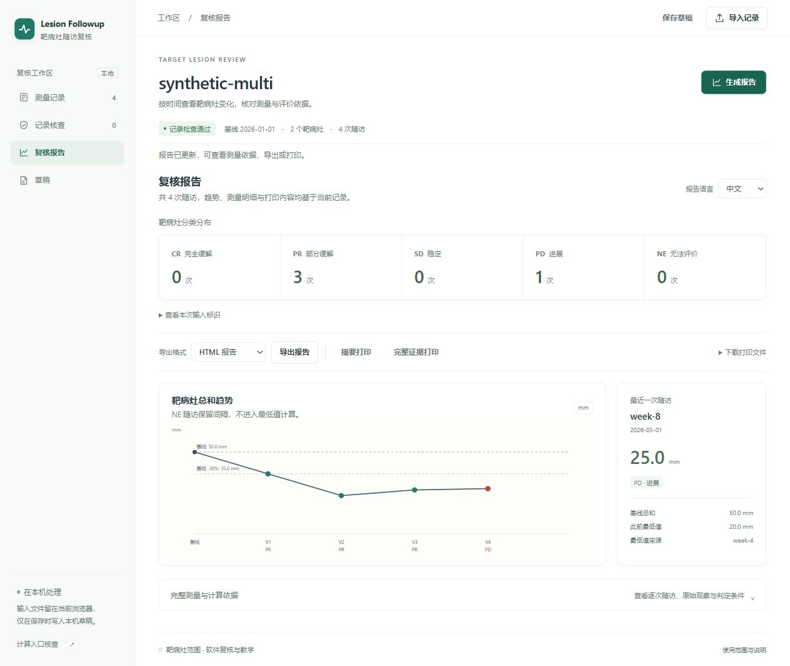

# lesion-followup

An offline MoonBit library for reviewing manually measured CT target lesions.
It keeps baseline and historical-minimum references explicit and returns each
target category together with the measurements and rules that support it.

**靶病灶随访复核：保留每次计算的基线、历史最低值和测量依据。**

This project implements a documented RECIST 1.1 **target-lesion subset** for
software review and education. It does not read images, choose targets, evaluate
non-target disease or new lesions, assign overall response, or recommend
treatment. All included cases are synthetic. A target CR/PR/SD/PD is not an
overall CR/PR/SD/PD.

## Run the demos

Install the [MoonBit toolchain](https://www.moonbitlang.com/download/), then run
from this checkout:

```sh
moon run --target native cmd/demo -- --scenario nadir-boundary
moon run --target native cmd/demo -- --scenario node-resolution --format json
moon run --target native cmd/demo -- --scenario missing-visit --format svg
moon run --target native cmd/demo -- --study examples/study.json --input examples/followup.csv --format html --output review.html
moon run --target native cmd/demo -- --study examples/study.json --input examples/followup.csv --check-input --format json
moon run --target native cmd/demo -- --scenario nadir-boundary --bundle review-bundle
moon run --target native cmd/demo -- --init-example new-inputs --template multi --lang zh-CN
moon run --target native cmd/demo -- --study new-inputs/study.json --input new-inputs/followup.csv --format html --lang zh-CN --output new-inputs/review.html
```

Open [the saved example report](examples/review.html) locally for an immediate
preview. It contains inline CSS and SVG with no JavaScript or external assets.
Category cards and ledger rows link to the relevant visit evidence.
The [Chinese example report](examples/review.zh-CN.html) includes the same
quantities and categories, translated explanations and individual-target trends.

The [complete review collection](examples/review-cases/README.md) covers multiple
targets, missing observations, changed acquisition identifiers and revision
effects, with hand-calculated expectations and importable workbench drafts:

```sh
python scripts/reproduce_examples.py --output _build/review-examples
```

Version 0.2.0 candidate packaging, compatibility and installation checks are
documented in the [release guide](docs/release.md). Windows and Linux CI run the
same acceptance suite from clean checkouts, including independent consumption of
the extracted candidate package. Registry publication is recorded separately.

The current workbench also provides direct selection of the complete synthetic
examples, fixed-reference revision comparison and portable two-version review
sessions. See the [workbench guide](docs/workbench.md) for saving both original
source pairs and restoring them for a fresh comparison. Saved sessions can be
reviewed as an independent batch, exported as native-compatible report ZIPs and
checked again through the browser's bundle-integrity view. A separate human-review
checklist retains viewing states and comments, with input-bound note files and
independent HTML/Markdown explanations; core findings and categories stay intact.
Complete handoff ZIPs carry both input versions, native reports and optional
notes, with full report regeneration before explicit workspace restoration.
Whole-visit editing adds blank observations for every baseline target, updates
shared visit information and removes visits after preview. Current-input undo
and redo retain exact text within a bounded in-memory history; see the
[editing contract](docs/input-editing.md).
The per-target form records one visit's observation states, measured diameters
or reader limitations together, with a change preview and atomic save.
External projects can follow the [integration guide](docs/integration.md),
which distinguishes extracted-candidate validation from registry installation.

### Prepare and check inputs

`--init-example NEW_DIRECTORY` creates `study.json`, `followup.csv` and filling
instructions in `README.md`. Choose `--template single` (default) or `multi`.
The parent directory must exist. Initialization requires a new directory and
never merges into an existing file, directory or symlink. Both templates contain
matched, directly runnable synthetic data. Initialization accepts only
`--template` and `--lang` alongside its destination.

`--check-input` separates parsing errors, structural errors and reader-review
hints. Hints include omitted/explicitly missing measurements, reader limitations,
the explicit 5.0 mm default, technique changes and persistent context gates.
It reuses the replay engine's findings and returns no response categories.
Structural errors carry CSV cell positions or JSON field paths. An omitted
target uses the visit's first row as an anchor with a null field, because no
measurement cell exists. No input is sorted, repaired or overwritten.

The JSON validation envelope keeps `schema_version`, `valid`, `visit_count`,
`diagnostics` and `input_issues`, and adds `review_hints` and source locations.
`valid: true` means parse and structural checks passed; review hints can still be
present. Exit status remains 0 for valid input and 2 for input errors.

### Display language and individual observations

`--lang en` (default) or `--lang zh-CN` selects HTML, Markdown, SVG and human CLI
presentation, including preflight and template instructions. Machine-readable
JSON/CSV bytes and stable codes remain language independent. Reader notes and
identifiers are retained verbatim, escaped for the output format. Diagnostic
summaries are translated while retaining the original detailed diagnostic.

HTML and Markdown add an individual-target observation ledger. HTML also adds
one plot per target with an independent vertical scale and labels for longest
diameter or node short axis. A square marks the explicit 5.0 mm default; a cross
has no diameter. A hollow marker preserves an available observation from an NE
visit. Lines stop at NE or missing visits. These observations do not make that
visit eligible for the sum trend or nadir. The standalone `svg` CLI format
continues to export the sum chart.

### Explain calculations and compare revisions

HTML and Markdown now expand the exact conditions for each visit. JSON adds
`rule_checks` with integer operands, an operator, a nullable result and `active`.
S is the current sum, B the baseline, and N the prior eligible minimum.
The trace shows `5*S >= 6*N`, `S-N >= 50` and `10*S <= 7*B` in 0.1 mm units,
plus completeness, technique/context gates and per-target CR conditions.
An inactive comparison can be numerically true without selecting a category;
earlier gates and rule priority still apply. Findings explain NE requirements.

Compare two independent replays of the same exact baseline profile:

```sh
moon run --target native cmd/demo -- --study examples/study.json --input examples/followup.revised.csv --compare-study examples/study.json --compare-input examples/followup.csv --format html --lang zh-CN --output revision.html
```

The revised files use `--study` and `--input`; original files use
`--compare-study` and `--compare-input`. Output supports JSON, Markdown and HTML.
Both tracks must have identical study identity, baseline, acquisition metadata
and ordered baseline target set. Visits and observations are aligned by IDs.
Input additions, removals and changed fields are separate from downstream
assessment changes. Identical input gives an empty difference. All four source
paths are protected from output replacement.

The [saved Chinese comparison](examples/revision.zh-CN.html) changes week-4 T1
from 10.0 to 9.0 mm. The minimum becomes 19.0 instead of 20.0 mm; week-6's
24.0 mm sum then meets both PD conditions, and week-8 requires post-PD review.

### Verify bundles and review batches

```sh
moon run --target native cmd/demo -- --study examples/study.json --input examples/followup.csv --bundle review-bundle
moon run --target native cmd/demo -- --verify-bundle review-bundle --format json
moon run --target native cmd/demo -- --batch examples/batch.json --bundle new-batch-reviews --lang zh-CN
```

New bundles use manifest schema 2: software/rule versions, language, semantic
input fingerprints, raw-file SHA-256 when file inputs were used, and exact UTF-8
artifact lengths and SHA-256. There are no timestamps or local source paths.
Verification checks the four fixed artifact names, contents, semantic input
fingerprints and summary against `audit.json`; it rejects missing files,
modified bytes, unknown profiles/versions and unsafe names. It does not modify
the bundle. Hashes check integrity; they are not signatures or proof of author
identity. Original-file fingerprints are recorded, not rechecked against absent
source files. The legacy `render_audit_manifest` API still emits metadata-only
schema 1; use `render_bundle_manifest` for the verifiable schema 2.

The [batch manifest](examples/batch.json) uses schema 1 and a `cases` array of
`id`, `study` and `input`. Relative paths are resolved against that manifest's
directory. IDs are portable ASCII letters/digits/underscore/hyphen, at most
64 characters, unique ignoring case; device names and path components are
rejected. The list accepts 1–1000 cases. Use synthetic identifiers.

Batch output requires a new directory. Each successful case gets its own
verifiable bundle, and `index.json`/`index.html` retain every case, including
input and I/O failures. A failure does not stop later cases. Exit code 3 means
one or more cases failed; a global manifest error remains 2, and a global I/O
failure remains 1. Valid NE or PD reports still count as successful processing.

| Synthetic scenario | What it demonstrates | Ordered target categories |
| --- | --- | --- |
| `nadir-boundary` | Baseline 100.0 mm, then 20.0, 24.0, 25.0; PD needs both relative and absolute growth | PR, PR, PD |
| `node-resolution` | Node short axis 10.0 vs 9.9 mm; reappearance needs overall context | PR, CR, NE |
| `missing-visit` | An unmeasured visit cannot lower the nadir | PR, NE, PR, PD |

`--format` accepts `markdown`, `json`, `csv`, `svg`, or `html`. Without `--output`,
the report goes to standard output. Output parents must already exist. Existing
output files are replaced, except resolved source input paths are protected.
`--bundle` creates a directory containing `report.html`, `audit.json`, `audit.csv`,
`chart.svg`, and `manifest.json`; repeating the same input produces identical
artifact bytes. It replaces those named files in the selected directory.

CLI exit codes are `0` for valid input (including NE or PD observations), `2` for
arguments, parsing or structural validation errors, and `1` for I/O failures.
Batch partial failure uses `3` as described above.
`--check-input` validates schema and track structure and highlights review
requirements; the reader still determines clinical comparability.

## Public API

Consumers import the root package as `lib`:

```text
import { "impart563/lesion-followup" @lib }
```

The following example is compiled and tested with the library:

```mbt check
///|
test "exact target PD boundary through the public facade" {
  let study : @lib.Study = {
    id: "synthetic-example",
    baseline_date: "2026-01-01",
    technique_id: "ct-5mm",
    slice_thickness_tenths_mm: 50,
    targets: [
      { id: "T1", organ: "liver", kind: NonNodal, baseline_tenths_mm: 200, },
    ],
  }
  let visit : @lib.Visit = {
    id: "week-4",
    date: "2026-02-01",
    technique_id: "ct-5mm",
    measurements: [{ lesion_id: "T1", observation: Measured(250), }],
  }
  guard @lib.replay_track(study, [visit]) is Ok(trajectory) else {
    fail("valid example was rejected")
  }
  assert_eq(trajectory.assessments[0].response.code(), "PD")
  assert_eq(trajectory.assessments[0].nadir_visit_id, "baseline")
}
```

The root exports `Study`, `TargetLesion`, `LesionKind`, `Visit`, `Measurement`,
`Observation`, `Trajectory`, `VisitAssessment`, findings, issues and diagnostics;
`validate_study`, `validate_track`, `replay_track`; study-JSON and follow-up-CSV
parsers; and all public report renderers. The library uses no file or network I/O.
The native CLI uses `moonbitlang/async@0.19.4` for file and stream access.

New presentation APIs retain the original English entry points:
`render_audit_html_in`, `render_audit_markdown_in` and `render_trajectory_svg_in`
accept `ReportLanguage` (`English` or `SimplifiedChinese`).
`render_lesion_trends_svg` exports the individual-target plots.
`input_template_files` returns matched in-memory files;
`preflight_inputs` and `preflight_track` return a `PreflightReport`, whose
`is_valid()` checks blocking errors separately from `review_hints`.
`render_preflight_json` and `render_preflight_markdown` format that report.
`explain_assessment` exposes typed `RuleCheck` values; `compare_tracks` returns
`TrackRevision` with input changes and affected assessments. The bundle and
batch parsing/rendering APIs remain pure; filesystem operations stay in the CLI.

`replay_track` rejects structurally invalid tracks as a whole. Successful replay
snapshots the supplied arrays and preserves visit order. Missing or unsupported
observations are retained in NE assessments. Renderers expect a trajectory
returned by successful replay; callers should not mutate its arrays.

[The quickstart](examples/quickstart/main.mbt) exercises the facade directly.
[A separate consumer module](examples/downstream-consumer/main.mbt) verifies
external type construction, methods and reporting through a local workspace:

```sh
moon run --target native examples/quickstart
moon -C examples/downstream-consumer run --target native .
```

## Offline browser workbench

Build the local workbench, JavaScript ES module and synthetic smoke page:

```sh
python scripts/build_browser.py
```

`_build/browser/browser.js` exports `evaluate(request_json: string): string`.
The workbench in `_build/browser/index.html` imports paired JSON/CSV files,
edits baseline targets and follow-up observations, locates input problems and
previews the current target-only report. Input changes invalidate earlier
reports. Explicit local/portable drafts preserve unfinished records; summary and
full-evidence layouts support A4 printing and standalone HTML export.

The versioned JSON boundary supports review, preflight, templates and editable
text cells, revision comparison, report bundles, bundle validation and batch
indexes, using the existing MoonBit core. Input errors retain source locations;
valid NE observations remain successful evaluations. The adapter itself has no
file, network or storage access. Browser-side file selection, downloads and
explicit draft persistence belong to the workbench.

See [the workbench guide](docs/workbench.md) for local serving and the review
workflow, or [the browser contract](docs/browser-adapter.md) for application
integration. The build loads only local assets; it requires a local HTTP server
for browser module imports. No server-side computation or external service is
needed.



## Exact inputs and evidence

[Study JSON](examples/study.json) declares `schema_version: 1`, a baseline date,
a comparable technique ID, CT slice thickness, and a fixed one-to-five target
set. Non-nodal targets use longest diameter; nodes use short axis. All nodes use
the single organ group `lymph_nodes`. Callers supply canonical organ groups and
must combine paired organs consistently. Each group may have at most two targets.

Diameters are unsigned decimal **strings** with at most one decimal place in
JSON, and plain decimal fields in CSV. The API uses tenths of a millimetre.
No input values are rounded. CT slices must be 0.1–5.0 mm; baseline target minima
are 10.0 mm for non-nodal lesions and 15.0 mm for nodes. The software limit per
diameter is 1000.0 mm. MRI, thicker CT slices and other acquisition methods are
outside this version's input contract.

The [long-form CSV](examples/followup.csv) has this exact header:

```csv
visit_id,date,technique_id,lesion_id,state,diameter_mm,note
```

Rows for one visit must be contiguous and repeat identical date and technique.
Visits use unique IDs and strictly increasing Gregorian `YYYY-MM-DD` dates after
baseline; `baseline` is a reserved visit ID. The parser never sorts rows. It
supports quoted commas, escaped quotes, multiline fields, CRLF and a UTF-8 BOM.
Parse diagnostics carry one-based physical line, column and field positions.
Structural validation issues identify visits and targets but do not carry CSV
locations. JSON schema errors identify field paths; unknown fields are rejected.

| `state` | `diameter_mm` | `note` | Meaning |
| --- | --- | --- | --- |
| `measured` | Required decimal | Empty | Reader's actual diameter, including sub-5-mm measurements |
| `absent` | Empty | Empty | Explicitly disappeared; effective size 0.0 mm |
| `too_small` | Empty | Empty | Visible but not reproducibly measurable; explicit 5.0 mm default |
| `missing` | Empty | Empty | Unmeasured, never imputed as zero |
| `not_evaluable` | Empty | Required reason | Reader-supplied limitation, such as lesion coalescence |

Omitted baseline targets behave as `missing`. Unknown targets and duplicate
measurements are structural errors. An empty visit can be supplied through the
API; CSV needs at least one explicit `missing` row to represent that visit.

Audit JSON retains the study, original observations, resolved diameters, target
category, prior nadir visit, and findings. CSV uses `assessment`, `measurement`
and `finding` detail rows. Missing quantities use JSON `null` or blank CSV fields.
Percent changes use integer basis points in JSON and two decimal places in
display reports, truncated toward zero. Exact integer comparisons determine
categories independently of displayed percentages.

## Rule boundaries

PR uses baseline; PD uses the prior complete eligible minimum and requires both
growth conditions. Node CR retains actual node size below 10 mm in the sum.
NE visits do not change the reference. Technique changes require review.
After target PD, further classifications are outside this release. Reappearance
after target CR, or loss of a prior PR threshold without PD, requires response
context and produces NE rather than an inferred overall category. These review
gates persist for the remaining track.

See [rule semantics and sources](docs/rule-semantics.md) for exact comparisons,
conservative exclusions, and the difference between target and overall response.
This implementation does not establish clinical or regulatory validation.

## Checks

```sh
python scripts/acceptance.py
```

The acceptance script discovers `moon` on PATH or in `~/.moon/bin`, requires only
Python 3.8+ standard library plus Node.js for browser-module checks, runs warning-free all-target checks/tests, native
build, README examples, public interfaces, a separate consumer module, five-format
consistency, browser/native parity, deterministic bundles, CLI failures and escaping checks, and builds
the Mooncakes source package. [Acceptance details](docs/acceptance.md) and the
[recorded local result](docs/acceptance-results.json) identify verified commands
and the source fingerprint. The same script is configured in CI.

## License

Apache-2.0 for this project's code and original documentation. The RECIST name,
source publications and linked materials retain their respective ownership and
terms. Official PDFs, forms and images are not redistributed here.
